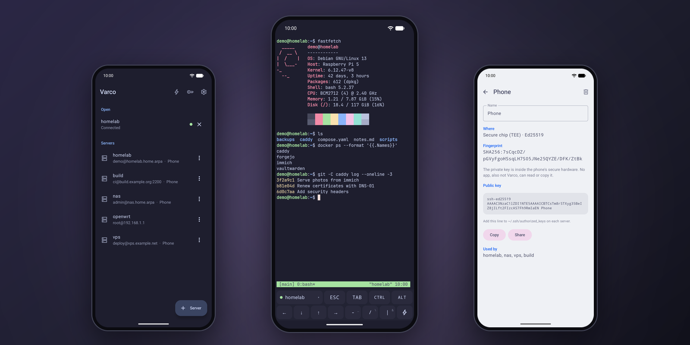

<div align="center">


# Varco

**Private, minimal SSH client and terminal for Android.**<br>
Modern SSH with post-quantum key exchange, and keys that stay in the phone's secure chip or on a
YubiKey. No trackers, no Google Play Services.

[](#build)
[](#security)
[](https://github.com/Turtlecute33/Varco/releases)
[](LICENSE)



</div>

## About

Varco is an SSH client for Android 15 and later. It uses the Termux terminal engine, so vim, htop,
tmux and other full-screen programs work correctly. New keys are made in the phone's secure chip,
and the private key can never go out of the chip.

Varco has a small number of features, and thus a small attack surface. It does not have port
forwarding, jump hosts, Mosh, agent forwarding or FIDO2 security keys.

## Features

- **Terminal**: the Termux terminal engine (true colour, mouse, vim, htop, tmux), full screen,
  with an extra-keys bar (ESC, TAB, CTRL, ALT, arrows, `- / |`, snippets). Pinch to zoom.
- **Sessions**: more than one session at the same time. Sessions stay connected in the
  background. A reconnect keeps the screen and the scrollback.
- **Keys**: new keys in the secure chip (Ed25519 or ECDSA P-256), YubiKey PIV keys over NFC and
  USB-C, and imported OpenSSH keys (also with a passphrase).
- **Import from Termux**: private keys, `~/.ssh/config`, `known_hosts`,
  `~/.termux/colors.properties` and `~/.termux/font.ttf`, directly from the Termux home folder.
- **SFTP file browser**: open folders, download and upload files. Varco asks before an upload
  replaces a file.
- **Snippets**: saved commands, one tap away in the extra-keys bar.
- **13 colour schemes**: Catppuccin (4), Tokyo Night, Dracula, Nord, Gruvbox, One Dark, Rosé
  Pine, Solarized (2) and Termux. The app colours follow the terminal scheme.

<details>
<summary><b>Import from Termux: the steps</b></summary>

1. In Varco: Settings → Import from Termux → Choose files.
2. In the file picker, open the menu (⋮) and turn on "Show hidden files".
3. Open "Termux" in the side panel, then `.ssh`. Select your keys, `config` and `known_hosts`.

No file goes through shared storage, and Termux needs no change.

</details>

<details>
<summary><b>YubiKey (PIV): the steps</b></summary>

Keys → Add YubiKey → hold the key to the phone (or plug it in). Varco reads the public keys of
slots 9a, 9c, 9d and 9e (no PIN is necessary), and you select one. Then add this key to the
server. On each connection, Varco asks for the PIN and then for the YubiKey.

Supported keys: RSA, ECDSA P-256, and Ed25519 on firmware 5.7 and later.

</details>

## Security

- **Modern algorithms only.** Key exchange: post-quantum hybrids first
  (`mlkem768x25519-sha256`, `sntrup761x25519-sha512`), then `curve25519-sha256`, ECDH and
  Diffie-Hellman with SHA-2. Ciphers: `chacha20-poly1305`, AES-GCM and AES-CTR. MACs: HMAC-SHA2,
  encrypt-then-MAC first. No SHA-1, no CBC and no `ssh-rsa` signatures.
- **Strict host key check.** A new host key needs your yes, and Varco shows its SHA-256
  fingerprint. If a known server shows a different key of the same type, Varco stops. Only
  "Replace key" lets the connection continue. Varco also uses the `known_hosts` lines that you
  import, and `@revoked` lines block a key. Settings > Trusted host keys shows each key with its
  fingerprint; you can delete a key or clear the imported lines.
- **Keys in the secure chip.** The Android Keystore (StrongBox or TEE) makes and keeps the key.
  No app can read or copy it, also not Varco. Imported keys move into the chip when the phone
  can hold their type. As an option, a key can ask for a fingerprint or the screen lock on each
  use.
- **YubiKey.** The key signs on the YubiKey. Varco first makes sure that the slot holds the
  expected public key, and only then sends the PIN.
- **Encrypted data.** Servers, saved passwords, imported keys, snippets and host keys are in one
  file. A Keystore key (StrongBox when available) encrypts it with AES-256-GCM.
- **Screen and keyboard.** Screenshots and the Recents preview are blocked by default. The
  keyboard does not learn what you type.
- **Clipboard.** Text that you copy in the terminal is marked sensitive and is cleared after 1
  minute. Servers cannot set the clipboard (OSC 52) unless you allow it.
- **App lock** (optional): fingerprint or screen lock to open Varco. Sessions stay connected.
- **Memory tagging** (MTE) in sync mode on phones that have it, such as Pixel 8 and later.
- **Verified build.** The build checks the SHA-256 of each dependency and of the Gradle
  distribution.

## Privacy

- No analytics, no crash reporting, no ads, no Google Play Services, no account.
- Varco connects only to the SSH servers that you add. It sends no HTTP requests, and it does not
  ask for a downloadable font.
- Varco does not log terminal data. The notification shows only the number of open sessions.
- No backups: your data stays out of cloud backup and device transfer.
- Permissions: Internet (SSH), foreground service and notifications (sessions stay open in the
  background), biometrics (app lock and keys), NFC (YubiKey) and vibration (terminal bell).

## Download

Get the APK from [Releases](https://github.com/Turtlecute33/Varco/releases). Varco is new
software. Report problems in [Issues](https://github.com/Turtlecute33/Varco/issues).

Before you install, check the signing certificate. Its SHA-256 fingerprint is:

```text
c1c9b7b77e23d028d155ceaef96f80b8b18bf69222b2efc6ff7fff1e99b0a9d9
```

Compare it with the output of `apksigner verify --print-certs <file>.apk`, or use AppVerifier.
Do not install an APK with a different certificate.

## Build

Requirements: JDK 21 and the Android SDK with platform 37.

```sh
JAVA_HOME=/opt/homebrew/opt/openjdk@21 ./gradlew :app:assembleDebug :app:testDebugUnitTest
```

Release builds are signed with the key that `scripts/make-release-key.sh` makes (the passwords
are only in the macOS Keychain). Without that key, `assembleRelease` makes an unsigned APK. The
release APK is about 3.5 MB.

<details>
<summary><b>Project layout</b></summary>

- `terminal/`: the Termux terminal engine, changed for remote byte streams (see
  `terminal/NOTICE.md`).
- `app/src/main/kotlin/app/varco/ssh`: connection, host keys, terminal sessions, SFTP.
- `app/src/main/kotlin/app/varco/keys`: secure chip keys, YubiKey PIV, SSH key formats.
- `app/src/main/kotlin/app/varco/data`: the encrypted store and its Keystore key.
- `app/src/main/kotlin/app/varco/importer`: Termux import (keys, `ssh_config`, colours).
- `app/src/main/kotlin/app/varco/service`: the foreground service for open sessions.
- `app/src/main/kotlin/app/varco/ui`: theme, shared components, navigation and screens.
- `docs/DESIGN.md`: fixed decisions and security rules.

</details>

<details>
<summary><b>Validation</b></summary>

Run the JVM tests, lint and the two builds:

```sh
./gradlew :app:testDebugUnitTest :app:lintDebug :app:assembleDebug :app:assembleRelease
```

The tests cover the `ssh_config` parser, the Termux colours, `known_hosts`, the key formats, the
PIV padding and the store format.

On an Android 15 emulator, against OpenSSH 10.3, these steps were tested: keys in the secure chip,
imported Ed25519 (with a passphrase), RSA and ECDSA keys, a changed host key, the screen lock for
each use, the app lock, reconnect, vim, true colour, the extra keys, snippets, SFTP and the Termux
import. The connection used `mlkem768x25519-sha256` and `chacha20-poly1305@openssh.com`.

The emulator cannot test the YubiKey (NFC and USB), StrongBox and pinch to zoom.

</details>

## License

Varco is free software under the [GNU General Public License v3.0](LICENSE). The terminal engine
comes from Termux (GPL-3.0, with Apache-2.0 parts); see `terminal/NOTICE.md`. Other parts: JSch
with JZlib (BSD-3-Clause) and jBCrypt (ISC), Bouncy Castle (MIT), YubiKit, AndroidX, Jetpack
Compose and Kotlin coroutines (Apache-2.0), JetBrains Mono (OFL-1.1) and Material Symbols
(Apache-2.0). The licence texts are in [`docs/licences/`](docs/licences/), and the app shows them
in Settings > Open-source licences.

---

<sub>Varco is an independent project. It is not affiliated with Termux or Yubico.</sub>
